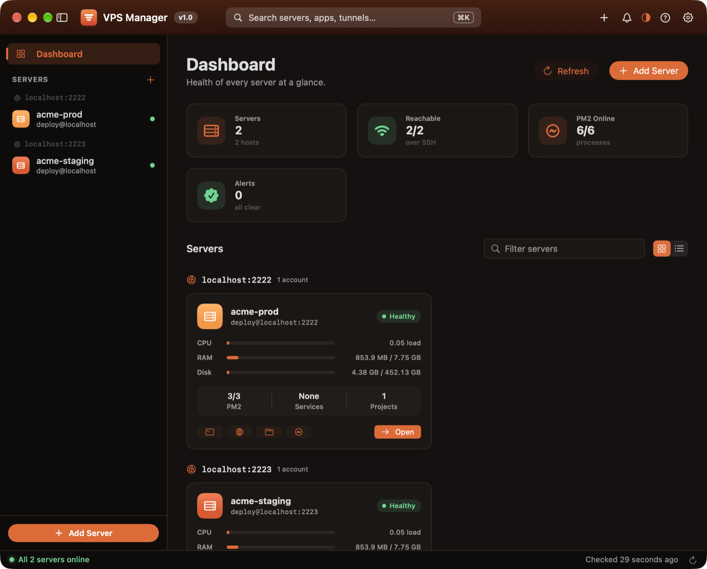
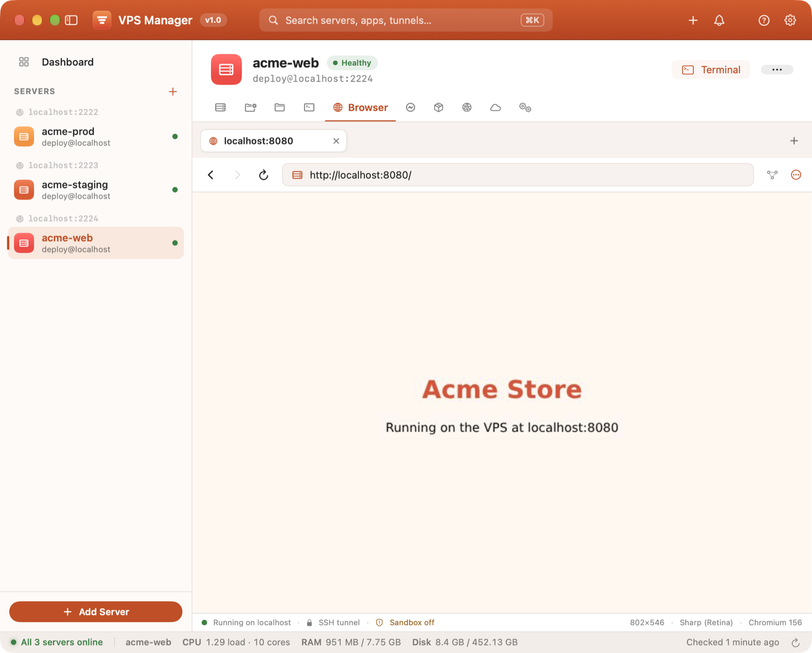
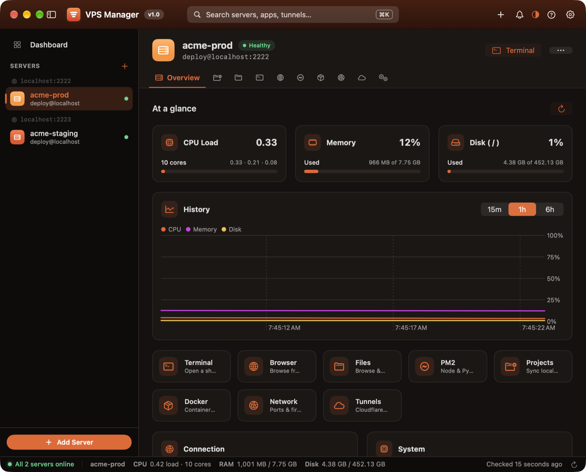
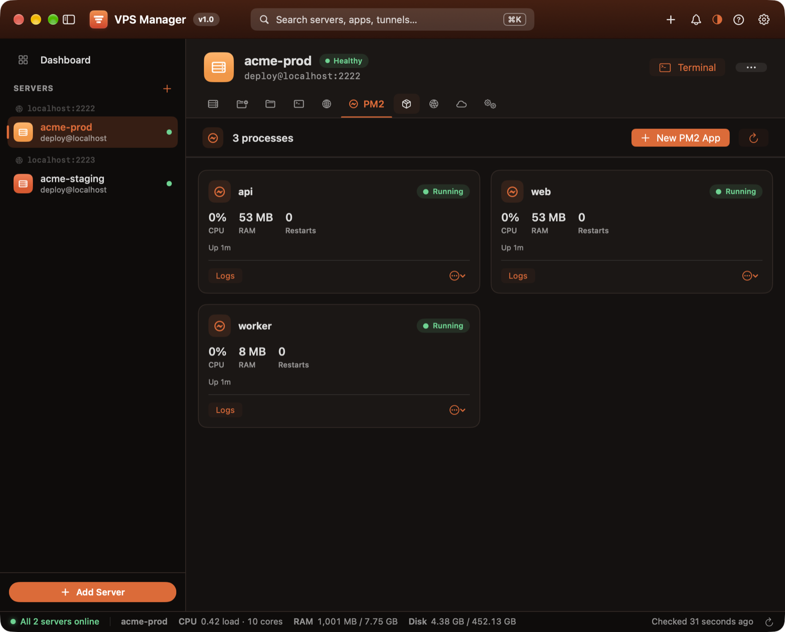
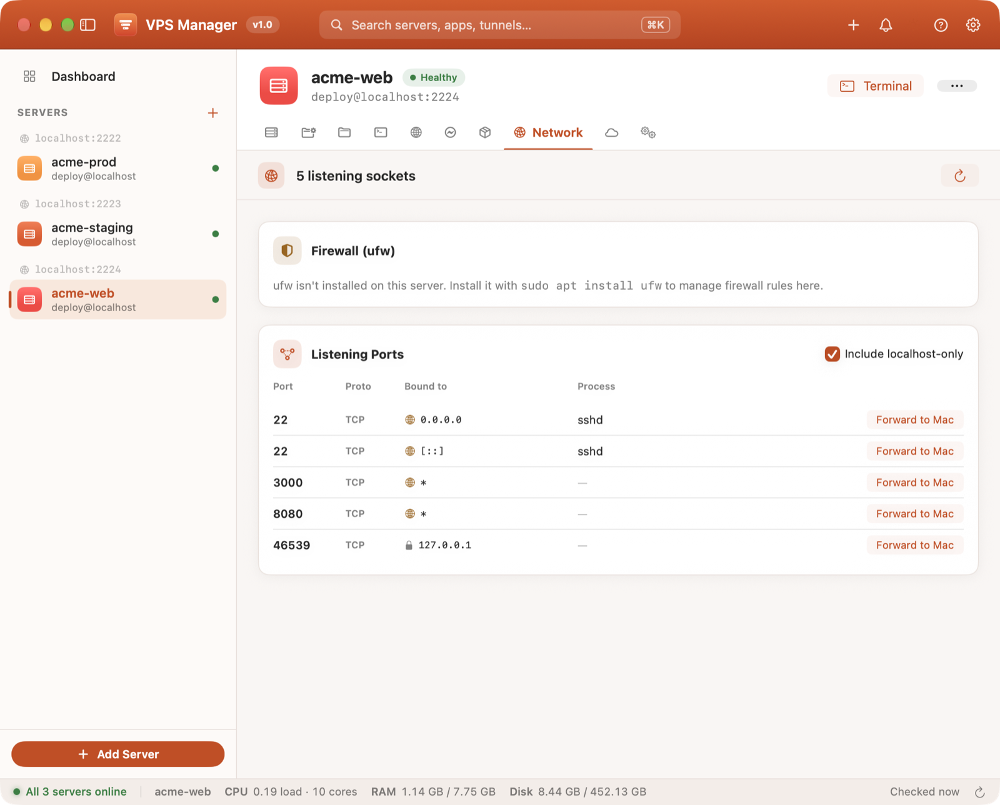
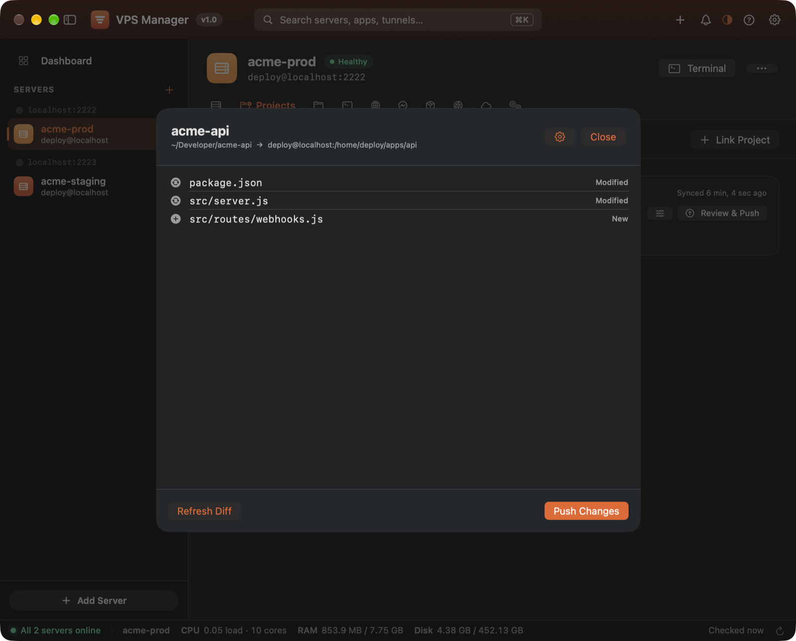
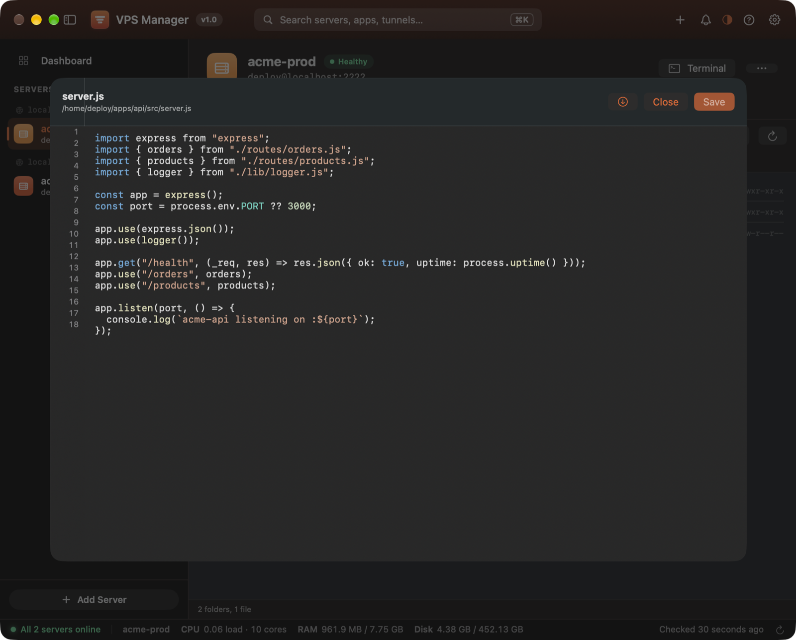
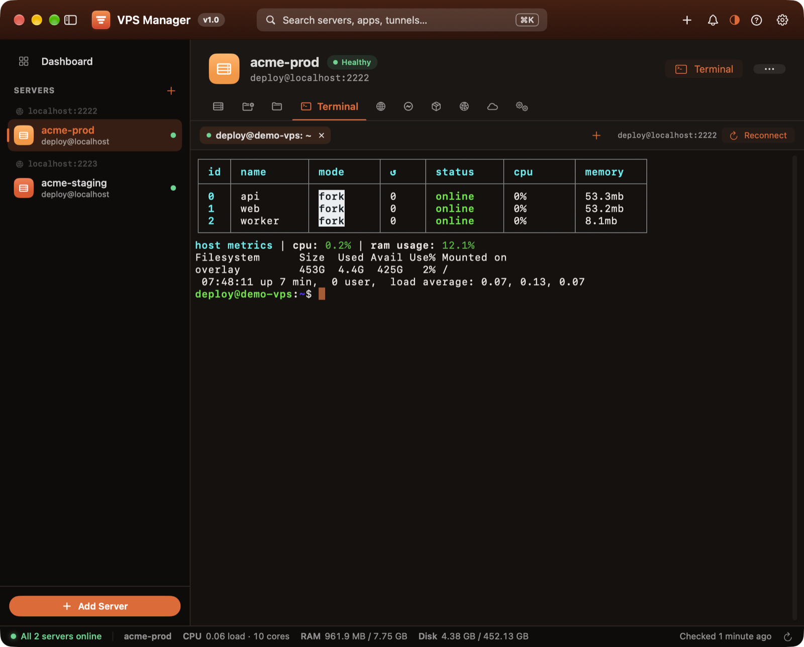
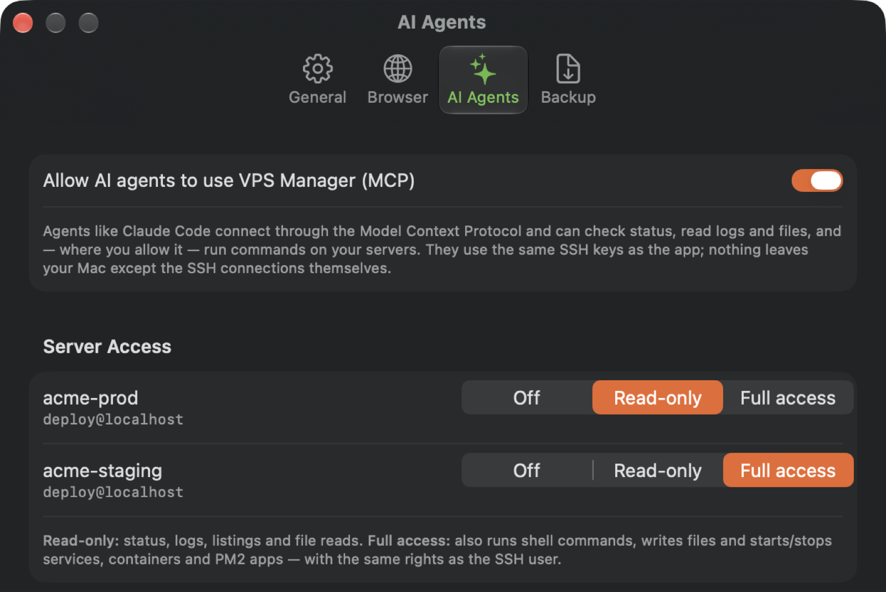

# VPS Manager

A native macOS app (SwiftUI, a warm red/orange design with light and dark themes) for
managing your VPS fleet: server hardening, project sync (local ↔ VPS), a remote file
browser/editor, an embedded terminal, a **remote browser that runs on the VPS**, PM2 process
management with a creation wizard, and Cloudflare Tunnel management with DNS + config
automation.

It works by shelling out to the real `ssh`, `rsync`, `ssh-keygen` binaries already on your
Mac — so it's 100% compatible with whatever you've already configured manually, no custom
protocol reimplementation, no surprises.



| | |
|---|---|
|  |  |
|  |  |
|  |  |
|  |  |

## Download

**[Download VPSManager.dmg](https://github.com/virus-dev-official/vpsmanager/releases/latest/download/VPSManager.dmg)**
(macOS 14 Sonoma or later, Apple silicon and Intel).

Open the disk image and drag VPSManager into Applications. The app isn't notarized yet,
so the first time you open it, right-click it and choose **Open** (or allow it under
*System Settings → Privacy & Security*). After that it opens normally.

## Features

- **Server setup wizard**: turns a fresh root + password VPS into a hardened box with a sudo
  user, your SSH key, and root login and password auth turned off.
- **Project sync**: link a local folder to a path on the server, see a dry-run diff, then push
  with `rsync`. Optional auto-sync on save.
- **Files**: browse, edit, upload and preview remote files, with syntax highlighting.
- **Terminal**: a real embedded terminal (SwiftTerm) per server.
- **Remote browser**: a headless Chromium running *on the VPS*, streamed into the app, so
  `localhost` services on the server are one click away.
- **PM2**: dashboard, live logs, and a wizard that writes `ecosystem.config.js` for Node.js or
  Python apps and makes them survive reboots.
- **Docker, systemd and network**: containers, units, journal logs, listening ports and
  firewall status.
- **Cloudflare Tunnels**: route a port to a domain; tunnel, DNS and `config.yml` handled for you.
- **Fleet health**: one status poll for every server, with notifications when something goes
  down, a menu bar dropdown, and a quick switcher.
- **Move or reset a VPS**: wizards to migrate apps to a new server or wipe one back to clean.
- **AI agents (MCP)**: let Claude Code and other MCP clients check status, read logs and files,
  and (only where you allow it) run commands or push projects. Every call is logged in the app.
- **Backups**: settings mirrored to iCloud Drive or a git repo. Secrets (PM2 env vars) stay in
  the Keychain and are never written to backups.

## Requirements (building from source)

- macOS 14 (Sonoma) or later
- Xcode 15 or later
- `ssh`, `rsync`, `ssh-keygen` available on your Mac (all ship with macOS by default)
- On each VPS: `pm2` and `cloudflared` installed if you want those panels to work;
  standard `systemd`-based Linux (Ubuntu/Debian assumed)

## Opening the project

1. Clone or download this folder anywhere, e.g. `~/Developer/VPSManager`
2. Open **`VPSManager.xcodeproj`** in Xcode
3. Xcode will resolve the SwiftTerm dependency automatically (needs internet the first time)
4. Select the `VPSManager` scheme, target "My Mac", and hit **Run** (⌘R)

It builds a real `VPSManager.app` bundle with its icon and bundle ID, signed to run
locally, so no Apple developer account is needed. If you have one, you can pick your
team under *Signing & Capabilities*.

The project is generated from [`project.yml`](project.yml) with
[XcodeGen](https://github.com/yonaskolb/XcodeGen). If you change targets, settings or
dependencies, edit `project.yml`, run `xcodegen`, and commit both. New source files
under `Sources/VPSManager` are picked up the next time it's generated.

## Building the app

`./build_app.sh` builds a universal Release `VPSManager.app` from the same Xcode project
and installs it to `/Applications`. `./scripts/make_dmg.sh` builds the same app into
`dist/VPSManager.dmg`, which is what the release workflow attaches to each GitHub release.

`Package.swift` is still there for `swift build` / `swift run` from the command line.
That runs a bare executable rather than an app bundle, so use the Xcode project for
normal development.

SwiftTerm ships a Metal shader, so both Xcode and `swift build` need Xcode's Metal Toolchain.
If a build fails with "missing Metal Toolchain", install it once:

```bash
xcodebuild -downloadComponent MetalToolchain
```

## First run

- Click **+** in the sidebar to add your first server.
- If the server already accepts passwordless SSH for a non-root user, choose
  **"Already set up"** and enter its host/IP, that user, and the identity file
  (e.g. `~/.ssh/id_ed25519`).
- For a fresh VPS, choose **"Fresh VPS (root + password)"** instead — the wizard
  will create a sudo user, install your key, disable root login and password auth, and
  restart sshd for you, then verify passwordless login before finishing.

## Linking a project

Go to a server → **Projects** → **+**. Pick your local folder (e.g.
`~/Developer/my-app`), type or browse the remote path (e.g.
`/home/deploy/my-app`), adjust the exclude list (`.env`, `node_modules/`, etc. are
pre-filled), and hit **Link & Push Initial Files**. After that, opening the project shows
a dry-run diff before every push — you always see exactly what will change before you push.

## PM2 apps

**PM2** tab → **New PM2 App**. Choose Node.js or Python. For Python, the wizard scans the
project directory for existing venvs and `requirements.txt` files, or lets you create a
fresh venv. On deploy it writes a proper `ecosystem.config.js`, runs `pm2 start`,
`pm2 save`, and registers `pm2 startup` under systemd so processes survive a reboot —
not just a `pm2 start` that vanishes on restart.

## Cloudflare Tunnels

**Cloudflared** tab. First time on a server, it'll ask you to authenticate (opens the
Cloudflare authorization page in your browser). After that, **New Route** takes just a
port and a domain — it creates the tunnel if needed, writes `config.yml`, runs
`tunnel route dns`, and installs/restarts the `cloudflared` systemd service.

## Remote Browser

**Browser** section of any server. Click **Launch Browser** and a real headless Chromium starts
*on the VPS* and streams into the app — you click, scroll and type into it as if it were local.

- Every request leaves from the server's own IP, and `http://localhost:<port>` reaches services
  that only listen on the VPS (the services button in the toolbar lists every listening port).
- Chromium's DevTools port is bound to the VPS's `127.0.0.1` and reached through a dedicated
  `ssh -L` tunnel — nothing is exposed to the internet.
- Tabs, back/forward, zoom (⌘+ / ⌘− / ⌘0), ⌘L, ⌘R, ⌘T, ⌘W, ⌘[ / ⌘], copy & paste with the Mac
  clipboard, native menus for `<select>` dropdowns, JavaScript alerts/confirms/prompts, and
  downloads (saved to `~/Downloads` on the VPS).
- If no browser is installed, **Install Browser** installs Google Chrome (x86-64
  Debian/Ubuntu) or the distro's Chromium (needs passwordless sudo, ~400 MB).
- By default the browser keeps running between sessions so your tabs and logins persist;
  stop it from the ⋯ menu, or change this in **Settings → Browser** (also: search engine and
  stream quality).
- On servers that block Chromium's sandbox (containers, Ubuntu 23.10+ AppArmor) or when
  connected as root, it falls back to `--no-sandbox` and shows "Sandbox off" in the status bar.

## Systemd

**Systemd** tab shows status for common services (cloudflared, nginx, sshd, pm2, docker,
postgres, redis) plus any custom unit you add. Start/stop/restart/enable-at-boot, and a
live `journalctl` viewer per service.

## Project structure

```
Sources/VPSManager/
  App.swift                     — app entry point
  Models/                       — Server, Project, PM2AppConfig, CloudflareTunnel, etc.
  Persistence/Store.swift       — JSON-file-backed AppStore (~/Library/Application Support/VPSManager)
  Services/
    ShellService.swift          — Process wrapper for ssh/rsync
    PTYProcess.swift            — real pseudo-terminal wrapper (password prompts, live terminal)
    ServerSetupService.swift    — hardening wizard logic
    SyncService.swift           — rsync dry-run diff + push
    SFTPService.swift           — remote file browsing/read/write via ssh
    PM2Service.swift            — pm2 status, logs, ecosystem deploy
    CloudflaredService.swift    — tunnel/DNS/config.yml automation
    SystemdService.swift        — unit status/control
    CDPConnection.swift         — minimal Chrome DevTools Protocol WebSocket client
    RemoteBrowserSession.swift  — remote Chromium lifecycle, SSH tunnel, tabs, input, VPS scripts
  Terminal/TerminalView.swift   — SwiftTerm-backed embedded terminal
  Views/                        — all SwiftUI screens
    Theme.swift                 — brand palette (light/dark tokens), appearance mode, logo mark
    DesignSystem.swift          — shared cards, pills, meters, section bars
    RemoteBrowserView.swift     — Browser tab UI; RemoteBrowserCanvas.swift — input/stream surface
scripts/render_icon.swift       — regenerates the app icon PNGs from the logo geometry
```

## App Icon

The icon is three server blades stepping down into a "V", each with a status LED, white on an
orange-to-red brand squircle (Apple's macOS icon grid). It's generated from the same geometry as
the in-app logo (`BrandGlyph` in `Views/Theme.swift`) — to tweak it, edit both and run:

```bash
swift scripts/render_icon.swift
```

## Notes

- All data is stored locally on your Mac as JSON — no cloud, no accounts.
- Nothing is sent anywhere except direct SSH connections to servers you add.
- Sync is intentionally **push-only** (local → VPS) with a dry-run preview: edit locally,
  review, push.

## Contributing

Issues and pull requests are welcome. See [CONTRIBUTING.md](CONTRIBUTING.md).

## License

[MIT](LICENSE) © 2026 Virus. Made by [Virus](https://virusofficial.dev).
